 

## Sobre

<table width="100%">
<tr>
<td width="16%" valign="middle" align="center"></td>
<td width="61%" valign="middle" align="left">

<strong>Engenharia de Backend Python &amp; IA</strong>

Gosto de resolver problemas de ponta a ponta: transito bem entre o lado experimental da IA, seja ajustar um LLM ou arquitetar um agente, e a engenharia clássica de backend

Tenho interesse em colaborar em equipe, aprender assuntos e tecnologias novas, e prefiro soluções claras.

</td>
<td width="23%" valign="middle" align="right"></td>
</tr>
</table>

## Stack

<table width="100%">
<tr>
<td width="680" valign="top">
<strong>Linguagens & Frameworks</strong> 

  
<strong>IA Generativa & LLMs</strong> 

  
<strong>Dados & Busca</strong> 

  
<strong>Infra & Observabilidade</strong> 

  
<strong>Ferramentas de desenvolvimento com IA</strong> 

</td>
<td width="268" valign="middle" align="center">

</td>
</tr>
</table>

 

## Estatísticas

 

## Competências

**IA & Dados** <kbd>IA Generativa</kbd> &nbsp;<kbd>RAG Híbrido</kbd> &nbsp;<kbd>LLMs Locais</kbd> &nbsp;<kbd>Fine-tuning (LoRA/QLoRA)</kbd> &nbsp;<kbd>Bancos Vetoriais</kbd> &nbsp;<kbd>Visão Computacional</kbd> &nbsp;<kbd>NLP</kbd> &nbsp;<kbd>LLM Determinística</kbd>

**Engenharia** <kbd>Alta Disponibilidade</kbd> &nbsp;<kbd>Microsserviços</kbd> &nbsp;<kbd>API REST</kbd> &nbsp;<kbd>POO</kbd> &nbsp;<kbd>CI/CD</kbd> &nbsp;<kbd>Docker</kbd> &nbsp;<kbd>Servidores Linux</kbd> &nbsp;<kbd>OpenTelemetry</kbd> &nbsp;<kbd>Web Scraping</kbd> &nbsp;<kbd>SQL</kbd> &nbsp;<kbd>MinIO / S3</kbd> &nbsp;<kbd>Documentação de Software</kbd>

**Colaboração & Atitude** <kbd>Comunicação</kbd> &nbsp;<kbd>Trabalho em Equipe</kbd> &nbsp;<kbd>Resolução de Problemas</kbd> &nbsp;<kbd>Aprendizado Rápido</kbd> &nbsp;<kbd>Adaptação</kbd> &nbsp;<kbd>Organização</kbd> &nbsp;<kbd>Metodologias Ágeis</kbd>

 

---

